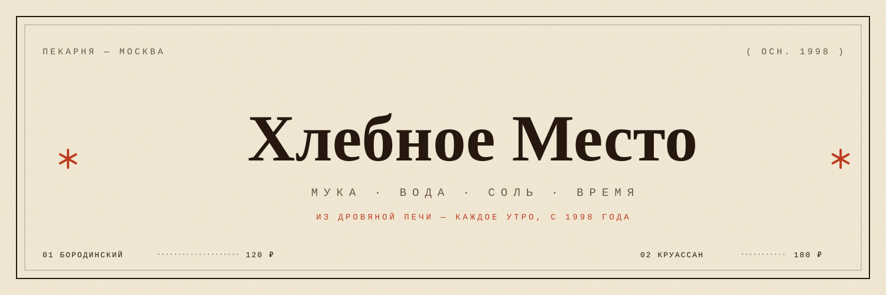
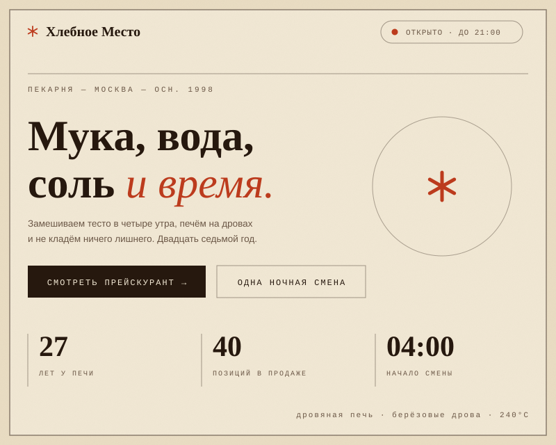
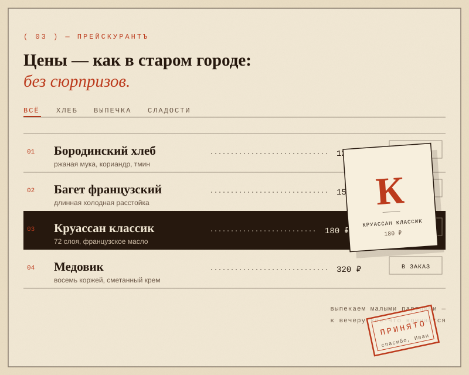
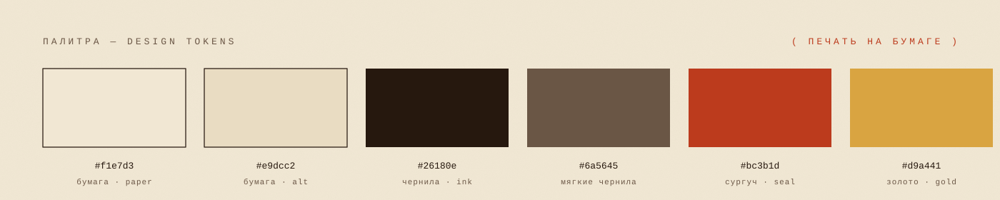

  
  
<em>Демо-сайт пекарни · bakery demo site</em>

---

  <table>
    <tr>
      <td width="50%"></td>
      <td width="50%"></td>
    </tr>
    <tr>
      <td align="center">Главный экран · Hero</td>
      <td align="center">Прейскурант · Price list</td>
    </tr>
  </table>
  

---

🇷🇺 **Русский**

Демо-сайт дровяной пекарни «Хлебное Место» (осн. 1998) в стиле архивного прейскуранта: бумага с зерном, чернила и сургучная печать. Меню — не карточки, а типографский список с пунктирными лидерами; отдельная тёмная глава про ночную смену; на отправленном бланке заказа шлёпается печать «ПРИНЯТО».

- Без бэкенда и сборки — просто откройте `index.html` в браузере
- HTML + CSS + ванильный JavaScript, шрифты с Google Fonts
- Живой статус «открыто / закрыто» по системным часам

🇬🇧 **English**

A demo website for the wood-fired bakery "Khlebnoye Mesto" (est. 1998), styled like an archival price list: grainy paper, ink and a wax-seal stamp. The menu is a typographic list with dotted leaders instead of cards, there's a dedicated dark chapter about the night shift, and a "RECEIVED" stamp slams onto the order form after you submit it.

- No backend, no build step — just open `index.html` in a browser
- HTML + CSS + vanilla JavaScript, fonts from Google Fonts
- A live "open / closed" status based on your system clock

🇪🇸 **Español**

Sitio de demostración de la panadería con horno de leña «Khlebnoye Mesto» (fundada en 1998), con estética de lista de precios de archivo: papel granulado, tinta y un sello de lacre. El menú es una lista tipográfica con puntos conductores en lugar de tarjetas, hay un capítulo oscuro dedicado al turno nocturno y, al enviar el formulario, un sello de «ACEPTADO» cae sobre el formulario de pedido.

- Sin backend ni compilación: solo abre `index.html` en el navegador
- HTML + CSS + JavaScript puro, fuentes de Google Fonts
- Estado «abierto / cerrado» según el reloj del sistema

🇫🇷 **Français**

Site vitrine de la boulangerie au feu de bois « Khlebnoïe Mesto » (fondée en 1998), dans un style de tarif d'archives : papier granuleux, encre et cachet de cire. Le menu est une liste typographique à points de suite plutôt que des cartes, un chapitre sombre est dédié au service de nuit, et un tampon « ACCEPTÉ » s'abat sur le bon de commande après l'envoi.

- Sans backend ni build : ouvrez simplement `index.html` dans un navigateur
- HTML + CSS + JavaScript vanilla, polices via Google Fonts
- Statut « ouvert / fermé » calculé sur l'horloge du système

🇩🇪 **Deutsch**

Demo-Website für die Holzofen-Bäckerei „Khlebnoje Mesto“ (gegr. 1998) im Stil eines Archiv-Preisverzeichnisses: körniges Papier, Tinte und ein Siegel aus Wachs. Das Menü ist eine typografische Liste mit Punktvorsätzen statt Karten, die Nachtschicht bekommt ein eigenes dunkles Kapitel, und nach dem Absenden knallt ein „ANGENOMMEN“-Stempel auf das Bestellformular.

- Ohne Backend und Build — einfach `index.html` im Browser öffnen
- HTML + CSS + Vanilla-JavaScript, Schriften von Google Fonts
- Live-Status „offen / geschlossen“ nach der Systemuhr

🇨🇳 **中文**

「面包之地」柴火面包坊（创立于 1998 年）的演示网站，采用档案价目表的风格：带颗粒感的纸张、墨色与火漆印章。菜单不是卡片，而是带点线的印刷体清单；另有关于夜班的深色章节；订单表单提交后，会“盖”上一枚「已受理」印章。

- 无需后端、无需构建 —— 直接在浏览器中打开 `index.html`
- HTML + CSS + 原生 JavaScript，字体来自 Google Fonts
- 根据系统时钟显示「营业中 / 已打烊」的实时状态

🇮🇳 **हिन्दी**

लकड़ी के चूल्हे वाली बेकरी «ख्लेबनोये मेस्तो» (स्थाप. 1998) की डेमो वेबसाइट, पुरालेखीय कीमत-सूची की शैली में: कण-कण वाला कागज़, स्याही और लाख की मुहर। मेन्यू कार्ड की जगह बिंदु-रेखाओं वाली टाइपोग्राफ़िक सूची है, रात की शिफ्ट के लिए एक गहरा अध्याय है, और फ़ॉर्म भरने पर ऑर्डर फॉर्म पर «प्राप्त» की मुहर गिरती है।

- कोई बैकएंड या बिल्ड नहीं — ब्राउज़र में सीधे `index.html` खोलें
- HTML + CSS + वैनिला जावास्क्रिप्ट, Google Fonts से फ़ॉन्ट
- सिस्टम घड़ी के अनुसार «खुला / बंद» लाइव स्टेटस

---

  HTML + CSS + vanilla JS · без бэкенда / no backend / sin backend / sans backend / ohne Backend / 无后端 / बैकएंड नहीं

